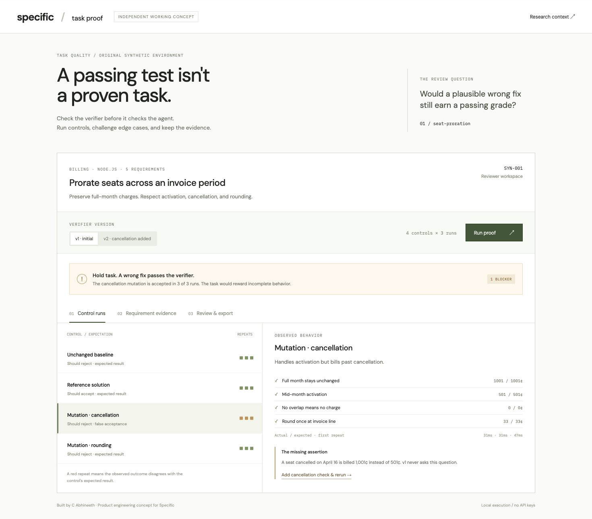

# Task Proof

An independent product engineering concept for Specific Labs. Review whether a coding-task verifier rejects plausible incomplete fixes before spending model evaluation budget.



## Why this workflow

Specific's public [Real-SWE methodology](https://withspecific.com/benchmarks/real-swe) describes private production repositories, company-specific requirements, isolated sandboxes, and grading-time verifier injection. A useful adjacent contribution is an executable verifier review: does a plausible wrong solution still pass? This is a product hypothesis, not a claim that Specific lacks internal quality tooling.

The visual treatment follows Specific's restrained typography, whitespace, thin borders, and quiet research presentation. No private assets or benchmark tasks are copied.

## Run

Node 22 or newer. No dependencies or API keys.

```sh
npm start
```

Open http://127.0.0.1:5188.

1. Run proof on **v1 · initial**. Three real executions accept the cancellation mutation, so the task is blocked.
2. Inspect the mutation and requirement evidence. R3 has no assertion.
3. Click **Add cancellation check & rerun**. The reference passes and both mutations plus baseline fail across three repeats each.
4. Inspect **Review & export**, add a note, and download the exact evidence JSON. Run UUID, fixture/version digest, all assertion results, and review state are included. Changing version or rerunning clears notes and old evidence.

```sh
npm test
npm run build
npm run proof -- strict > proof-output.json
```

The CLI emits JSON. Exit 0 means controls passed, 1 means blocked, and 2 means invalid configuration or runner failure. Weak mode deliberately exits 1:

```sh
npm run proof -- weak
```

For clean machine-readable output use `node src/cli.mjs strict` directly.

## What actually runs

`src/proof.mjs` launches the bundled `fixtures/run.mjs` via `execFile`, using only allowlisted verifier versions and hardcoded control variants. Every control executes three times in separate Node processes with a timeout and bounded output. No arbitrary command or upload execution is supported. The server binds to loopback.

The fixture is an original integer-cent seat-proration problem, distinct from Specific's published invoice-tax example. Controls: unchanged baseline, reference, cancellation omission, premature daily rounding. There are five hand-authored assertions. Repeats show reproducibility of these deterministic cases, not statistical flakiness certification.

## Honest boundaries

- This is a single-fixture local prototype, not a Harbor adapter or sandbox runner.
- The processes are not security-isolated. Do not use it for untrusted submissions.
- The full source is public, including verifier and reference logic. Agent/reviewer boundaries are conceptual in this demo, not an enforced data boundary.
- No Real-SWE code, licensed company data, model evaluation, leaderboard numbers, integration, or measured productivity gain is included.
- Passing controls does not prove verifier completeness, task fairness, production readiness, or hidden-test secrecy.
- Run results are held in memory in the browser until export. Reloading resets them. Reviewer notes are not an authenticated sign-off.
- Google Fonts is optional; system font fallbacks work offline. Execution itself is local.

## Layout

- `fixtures/`: original executable task, controls, assertions
- `src/proof.mjs`: repeated execution and evidence manifest
- `server.mjs`: local static server and bounded POST endpoint
- `app.js`, `style.css`: responsive review interface
- `tests/`: behavioral checks
- `screenshots/`: browser captures from localhost
- `OUTREACH.md`: copy-ready email

Research reviewed October 28, 2026:
- https://withspecific.com/
- https://withspecific.com/benchmarks/real-swe
- https://withspecific.com/company-data
